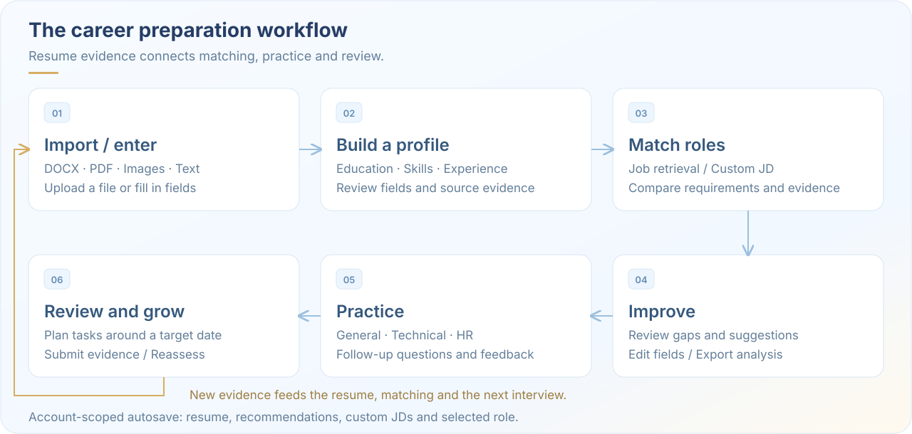
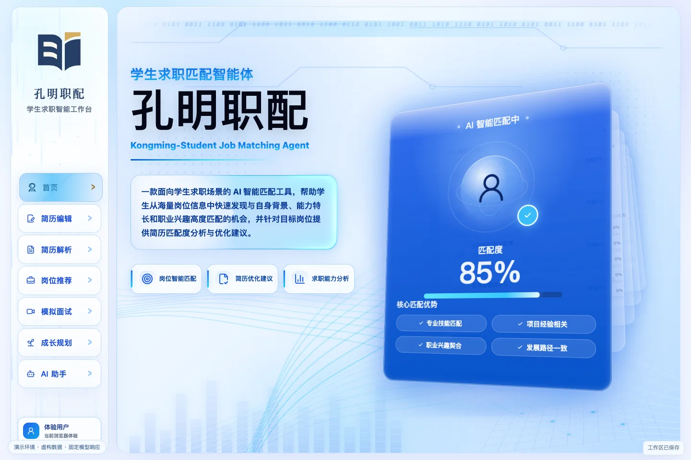
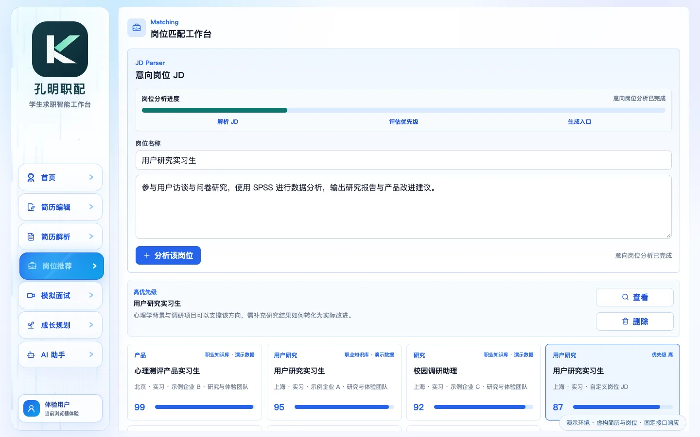
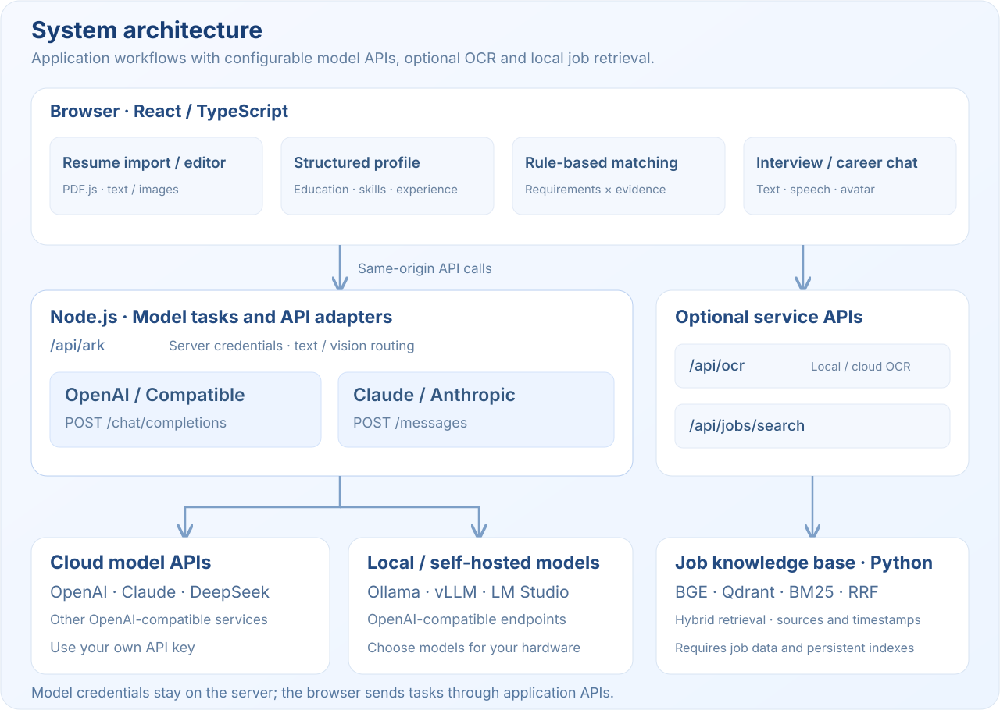

<p align="center">
  
</p>

<h1 align="center">Kongming · 孔明职配</h1>
<p align="center"><strong>Understand your resume. Explore the fit. Prepare your next step.</strong></p>
<p align="center">An AI workspace for student job seekers, connecting resume analysis, job matching, resume improvement and interview practice.</p>

<p align="center">
  <a href="LICENSE"></a>
  <a href="package.json"></a>
  <a href="package.json"></a>
  <a href="tsconfig.json"></a>
</p>

<p align="center">
  <a href="README.md">简体中文</a> · <strong>English</strong><br>
  <a href="#product-tour">Product tour</a> · <a href="#capabilities">Capabilities</a> · <a href="#quick-start">Quick start</a> · <a href="#architecture">Architecture</a> · <a href="docs/README.md">Documentation</a> · <a href="CONTRIBUTING.md">Contributing</a>
</p>

## Overview

Kongming brings a student's resume and target job into one workflow. It structures education, skills and experience, explains how the available evidence relates to job requirements, suggests resume improvements and provides interview practice for the selected role.

The application uses React and TypeScript with server-side adapters for OpenAI, Claude and OpenAI-compatible services, including local models through Ollama. OCR and a local job knowledge base are optional. The current release is a runnable application prototype; the interface and detailed documentation are primarily in Chinese.



## Product tour

[](docs/media/kongming-demo.mp4?raw=true)

**[Watch the full demo](docs/media/kongming-demo.mp4?raw=true)** · [Media and recording notes](docs/media/README.md)

The recording shows the running frontend with a fictional resume and fixed API responses. It demonstrates interactions and presentation; model quality and live retrieval require the corresponding services.

<table>
  <tr>
    <td width="50%"><a href="docs/media/home.webp"></a><br><strong>01 · Import a resume</strong><br>Upload a document or paste resume text.</td>
    <td width="50%"><a href="docs/media/editor.webp"></a><br><strong>02 · Review and edit</strong><br>Check structured fields against the original.</td>
  </tr>
  <tr>
    <td width="50%"><a href="docs/media/resume.webp"></a><br><strong>03 · Explore the profile</strong><br>Review experience, skills and matching evidence.</td>
    <td width="50%"><a href="docs/media/jobs.webp"></a><br><strong>04 · Analyze a target role</strong><br>Compare requirements and analyze a custom JD.</td>
  </tr>
  <tr>
    <td width="50%"><a href="docs/media/interview.webp"></a><br><strong>05 · Practice interviews</strong><br>Prepare for general, technical and HR interviews.</td>
    <td width="50%"><a href="docs/media/assistant.webp"></a><br><strong>06 · Discuss next steps</strong><br>Ask questions with resume and role context.</td>
  </tr>
</table>

## Capabilities

| Area | Available functionality |
| --- | --- |
| Resume parsing | Text, Markdown, PDF and images. PDF text extraction runs first; OCR can provide text and coordinates for scanned pages. |
| Profiles and explanations | Education, skills and experience organized into a student profile, with five matching dimensions. |
| Job recommendations | Custom JD analysis; optional vector + BM25 retrieval with source links and verification timestamps. |
| Resume improvement | Keyword gaps, evidence and action suggestions; copy an improvement draft or download a Markdown analysis report. |
| Interview practice | General, technical and HR modes with text answers. Speech and camera features depend on browser support and permissions. |
| Career assistant | Multi-turn questions grounded in the current resume, selected role and matching result. |

Match scores use the project's heuristic rules. They have not been calibrated against hiring outcomes and do not represent acceptance probabilities. If the local knowledge base is unavailable, the interface reports this and attempts model-generated role suggestions.

## Quick start

### Install

You need **Node.js 24.x** and npm.

```bash
git clone https://github.com/lljjcc426/Kongming-Student-Job-Matching-Agent.git
cd Kongming-Student-Job-Matching-Agent
npm ci
```

### Configure a model

Copy [`.env.example`](.env.example) to `.env`. Self-hosted installations use your own API credentials or your own model server.

| Service | `MODEL_PROVIDER` | Protocol |
| --- | --- | --- |
| OpenAI | `openai` | Chat Completions |
| Claude | `anthropic` | Native Anthropic Messages |
| Custom cloud / local endpoint | `openai-compatible` | OpenAI-compatible Chat Completions; e.g. DeepSeek, Qwen, vLLM or LM Studio |
| Ollama | `ollama` | Local OpenAI-compatible API |

**OpenAI example:**

```dotenv
MODEL_PROVIDER=openai
MODEL_BASE_URL=https://api.openai.com/v1
MODEL_API_KEY=your_openai_api_key
MODEL_TEXT_MODEL=gpt-4.1-mini
MODEL_VISION_MODEL=gpt-4.1-mini
```

<details>
<summary><strong>Claude configuration</strong></summary>

```dotenv
MODEL_PROVIDER=anthropic
MODEL_BASE_URL=https://api.anthropic.com/v1
MODEL_API_KEY=your_claude_api_key
MODEL_TEXT_MODEL=claude-sonnet-4-6
MODEL_VISION_MODEL=claude-sonnet-4-6
```

The backend uses the native Messages API, including system prompts and image inputs.

</details>

<details>
<summary><strong>Local models with Ollama</strong></summary>

Install and start [Ollama](https://ollama.com/), then download a vision model:

```bash
ollama pull qwen3-vl:8b
```

Configure `.env`:

```dotenv
MODEL_PROVIDER=ollama
MODEL_BASE_URL=http://127.0.0.1:11434/v1
MODEL_API_KEY=
MODEL_TEXT_MODEL=qwen3-vl:8b
MODEL_VISION_MODEL=qwen3-vl:8b
MODEL_REQUEST_TIMEOUT_MS=180000
```

Choose a model that fits your available memory and compute.

</details>

Text and vision models are configured separately. Vision models must support image input. Leave `MODEL_VISION_MODEL` empty for a text-only setup and use OCR for scans and images. Use model IDs available to your account or local runtime.

See the [configuration guide](docs/configuration.md#模型接入) for API key setup, custom endpoints, timeouts and troubleshooting.

### Run

```bash
node --env-file=.env --run dev
```

Open the local address printed in the terminal, usually **http://localhost:5173**. Upload a resume, review its structured fields, compare jobs and open interview practice or the assistant.

For a UI-only visit, `npm run dev` works without model credentials. Resume structuring, JD analysis and model conversations require a valid connection. The Node.js `--env-file` option loads server variables into the process.

### Optional services

| Integration | Requirements | Guide |
| --- | --- | --- |
| OCR | Python with RapidOCR, or Volcengine OCR credentials | [OCR integration](docs/12-ocr-integration.md) |
| Job knowledge base | Python 3.11, job JSONL, embeddings and a Qdrant local index | [Setup](docs/getting-started.md) · [Retrieval design](docs/14-job-rag-knowledge-base.md) |

Existing `setup:ocr`, `setup:rag` and `build:job-index` scripts target Windows / PowerShell with D-drive defaults. See the [setup guide](docs/getting-started.md) for macOS / Linux instructions. Job datasets, indexes and model weights are supplied separately.

## Architecture



| Layer | Implementation |
| --- | --- |
| Frontend | React 19, TypeScript, Vite, Recharts and Three.js / React Three Fiber. |
| Workflow | Business hooks and model adapters for resume processing, job analysis, interviews and chat. |
| Documents | PDF.js, RapidOCR / Volcengine OCR and coordinate-based source highlighting. |
| Model services | Node.js reads server credentials, adapts OpenAI / Claude protocols and routes text or vision tasks through same-origin APIs. |
| Optional retrieval | Python, LlamaIndex, BGE, Qdrant, BM25, RRF fusion and optional reranking. |

The job knowledge base requires Python, job data and persistent indexes. `npm run preview` serves static output without the development API middleware. See [configuration and deployment](docs/configuration.md).

## Repository layout

```text
src/        Frontend pages, components, workflows and adapters
server/     Model proxy, OCR and local retrieval services
api/        Model and OCR HTTP entry points
scripts/    Setup, job collection and verification tools
public/     Avatars, PDF character maps and static assets
docs/       Guides, design documents and demo media
.github/    Issue and pull request templates
```

## Documentation and contributions

[Documentation index](docs/README.md) · [Getting started](docs/getting-started.md) · [Configuration](docs/configuration.md) · [Contributing](CONTRIBUTING.md) · [Report an issue](https://github.com/lljjcc426/Kongming-Student-Job-Matching-Agent/issues/new/choose)

The documentation index groups usage guides, implementation notes and earlier design material. Planned capabilities in design documents should be read alongside the current implementation.

## License

Licensed under [Apache License 2.0](LICENSE). Third-party dependencies and bundled resources retain their respective license notices.
