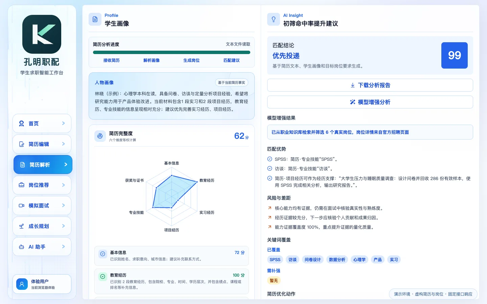
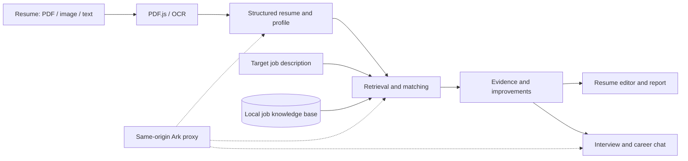

<p align="center">
  
</p>

<h1 align="center">Kongming · 孔明职配</h1>
<p align="center"><strong>Understand your resume. Explore the fit. Prepare your next step.</strong></p>
<p align="center">An AI workspace for student job seekers, connecting resume analysis, job matching, resume improvement and interview practice.</p>

<p align="center">
  <a href="LICENSE"></a>
  <a href="package.json"></a>
  <a href="package.json"></a>
  <a href="tsconfig.json"></a>
</p>

<p align="center">
  <a href="README.md">简体中文</a> · <strong>English</strong><br>
  <a href="#product-tour">Product tour</a> · <a href="#capabilities">Capabilities</a> · <a href="#quick-start">Quick start</a> · <a href="#architecture">Architecture</a> · <a href="docs/README.md">Documentation</a> · <a href="CONTRIBUTING.md">Contributing</a>
</p>

## Overview

Kongming brings a student's resume and target job into one workflow. It structures education, skills and experience, explains how the available evidence relates to job requirements, suggests resume improvements and provides interview practice for the selected role.

The application uses React and TypeScript with a same-origin backend for Volcengine Ark models. OCR and a local job knowledge base are optional integrations. The current release is a runnable application prototype; the interface and detailed documentation are primarily in Chinese.

## Product tour

[](docs/media/kongming-demo.mp4?raw=true)

**[Watch the full demo](docs/media/kongming-demo.mp4?raw=true)** · [Media and recording notes](docs/media/README.md)

The recording shows the running frontend with a fictional resume and fixed API responses. It demonstrates interactions and presentation; model quality and live retrieval require the corresponding services.

<table>
  <tr>
    <td width="50%"><br><strong>Resume analysis</strong><br>Review structured education, skills and experience.</td>
    <td width="50%"><br><strong>Job matching</strong><br>Compare requirements and analyze a target job description.</td>
  </tr>
  <tr>
    <td><br><strong>Resume editor</strong><br>Check extracted fields against the source.</td>
    <td><br><strong>Interview practice</strong><br>Prepare for general, technical and HR interviews.</td>
  </tr>
</table>

## Capabilities

| Area | Available functionality |
| --- | --- |
| Resume parsing | Text, Markdown, PDF and images. PDF text extraction runs first; OCR can provide text and coordinates for scanned pages. |
| Profiles and explanations | Education, skills and experience organized into a student profile, with five matching dimensions. |
| Job recommendations | Custom JD analysis; optional vector + BM25 retrieval with source links and verification timestamps. |
| Resume improvement | Keyword gaps, evidence and action suggestions; copy an improvement draft or download a Markdown analysis report. |
| Interview practice | General, technical and HR modes with text answers. Speech and camera features depend on browser support and permissions. |
| Career assistant | Multi-turn questions grounded in the current resume, selected role and matching result. |

Match scores use the project's heuristic rules. They have not been calibrated against hiring outcomes and do not represent acceptance probabilities. If the local knowledge base is unavailable, the interface reports this and attempts model-generated role suggestions.

## Quick start

### Install

You need **Node.js 24.x** and npm.

```bash
git clone https://github.com/lljjcc426/Kongming-Student-Job-Matching-Agent.git
cd Kongming-Student-Job-Matching-Agent
npm ci
```

Copy [`.env.example`](.env.example) to `.env` and enter an Ark API key and model IDs available to your account:

```dotenv
ARK_API_KEY=your_ark_api_key
ARK_TEXT_MODEL=your_text_model_id
ARK_VISION_MODEL=your_vision_model_id
```

### Run

```bash
node --env-file=.env --run dev
```

Open the local address printed in the terminal, usually **http://localhost:5173**. Upload a resume, review its structured fields, compare jobs and open interview practice or the assistant.

For a UI-only visit, `npm run dev` works without model credentials. Resume structuring, JD analysis and model conversations require a valid connection. The Node.js `--env-file` option loads server variables into the process.

### Optional services

| Integration | Requirements | Guide |
| --- | --- | --- |
| OCR | Python with RapidOCR, or Volcengine OCR credentials | [OCR integration](docs/12-ocr-integration.md) |
| Job knowledge base | Python 3.11, job JSONL, embeddings and a Qdrant local index | [Setup](docs/getting-started.md) · [Retrieval design](docs/14-job-rag-knowledge-base.md) |

Existing `setup:ocr`, `setup:rag` and `build:job-index` scripts target Windows / PowerShell with D-drive defaults. See the [setup guide](docs/getting-started.md) for macOS / Linux instructions. Job datasets, indexes and model weights are supplied separately.

## Architecture



| Layer | Implementation |
| --- | --- |
| Frontend | React 19, TypeScript, Vite, Recharts and Three.js / React Three Fiber. |
| Workflow | Business hooks and model adapters for resume processing, job analysis, interviews and chat. |
| Documents | PDF.js, RapidOCR / Volcengine OCR and coordinate-based source highlighting. |
| Model services | Vite development middleware and Vercel functions for model and cloud OCR requests. |
| Optional retrieval | Python, LlamaIndex, BGE, Qdrant, BM25, RRF fusion and optional reranking. |

Local Qdrant and persistent Python workers require storage and cannot run directly in Vercel Serverless. `npm run preview` serves static output without the development API middleware. See [configuration and deployment](docs/configuration.md).

## Repository layout

```text
src/        Frontend pages, components, workflows and adapters
server/     Model proxy, OCR and local retrieval services
api/        Vercel model and OCR entry points
scripts/    Setup, job collection and verification tools
public/     Avatars, PDF character maps and static assets
docs/       Guides, design documents and demo media
.github/    Issue and pull request templates
```

## Documentation and contributions

[Documentation index](docs/README.md) · [Getting started](docs/getting-started.md) · [Configuration](docs/configuration.md) · [Contributing](CONTRIBUTING.md) · [Report an issue](https://github.com/lljjcc426/Kongming-Student-Job-Matching-Agent/issues/new/choose)

The documentation index groups usage guides, implementation notes and earlier design material. Planned capabilities in design documents should be read alongside the current implementation.

## License

Licensed under [Apache License 2.0](LICENSE). Third-party dependencies and bundled resources retain their respective license notices.
