<p align="center">
  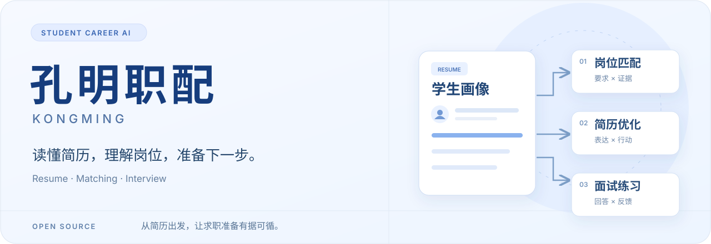
</p>

<h1 align="center">孔明职配 · Kongming</h1>

<p align="center"><strong>读懂简历，理解岗位，准备下一步。</strong></p>
<p align="center">面向学生求职的 AI 工作台，连接简历、岗位、面试与成长计划。</p>

<p align="center">
  <a href="LICENSE"></a>
  <a href="package.json"></a>
  <a href="package.json"></a>
  <a href="tsconfig.json"></a>
</p>

<p align="center">
  <strong>简体中文</strong> · <a href="README.en.md">English</a><br>
  <a href="#产品演示">产品演示</a> · <a href="#核心能力">核心能力</a> · <a href="#快速开始">快速开始</a> · <a href="#技术架构">技术架构</a> · <a href="docs/README.md">文档中心</a> · <a href="CONTRIBUTING.md">参与贡献</a>
</p>

## 项目介绍

孔明职配将学生简历与目标岗位放在同一个工作流中：提取教育、技能和经历，分析岗位要求与简历证据的关联，生成有依据的匹配说明与修改建议，再围绕目标岗位开展面试练习。

项目采用 React + TypeScript 构建交互界面，通过服务端适配 OpenAI、Claude 与 OpenAI 兼容接口，也可连接 Ollama 等本地模型；OCR 与岗位知识库按需启用。提供用户求职工作区与管理员服务控制台，使用 SQLite 保存账号、求职工作区、面试记录、成长计划及运维指标。

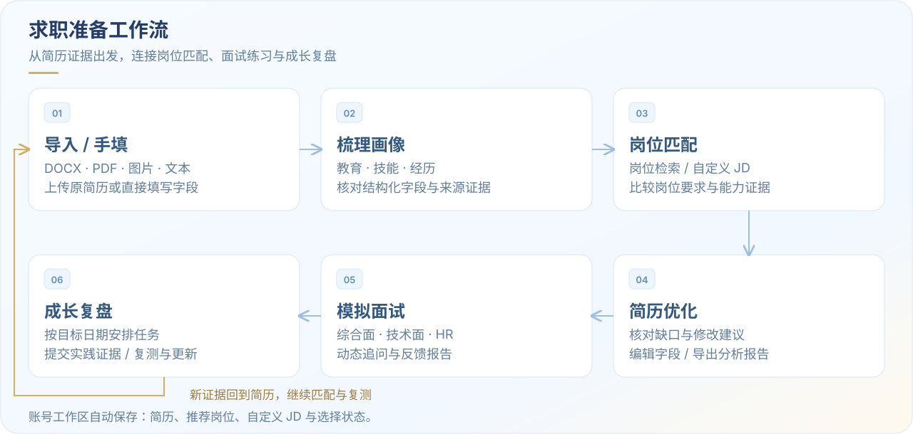

## 产品演示

[](docs/media/kongming-demo.mp4?raw=true)

<p align="center">
  <a href="docs/media/kongming-demo.mp4?raw=true"><strong>▶ 观看完整演示视频</strong></a> · <a href="docs/media/README.md">素材与录制说明</a>
</p>

演示展示实际运行的前端，使用虚构简历与固定接口响应，说明页面交互和结果呈现；模型效果与真实岗位检索需配置对应服务后体验。

<table>
  <tr>
    <td width="50%"><a href="docs/media/account.webp">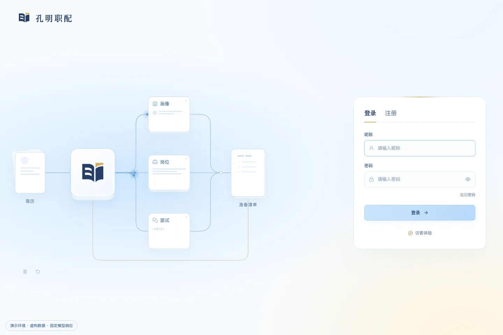</a><br><strong>01 · 登录与注册</strong><br>使用个人账号继续求职准备，也可先以访客身份体验。</td>
    <td width="50%"><a href="docs/media/home.webp"></a><br><strong>02 · 进入求职工作台</strong><br>从首页进入简历、岗位、面试与求职助手。</td>
  </tr>
  <tr>
    <td><a href="docs/media/editor.webp">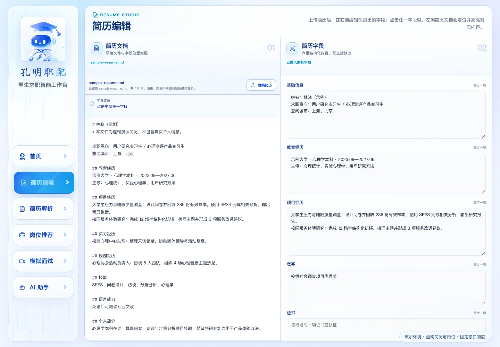</a><br><strong>03 · 导入与编辑简历</strong><br>上传 DOCX、PDF、图片或文本，也可直接填写字段并生成推荐。</td>
    <td><a href="docs/media/resume.webp">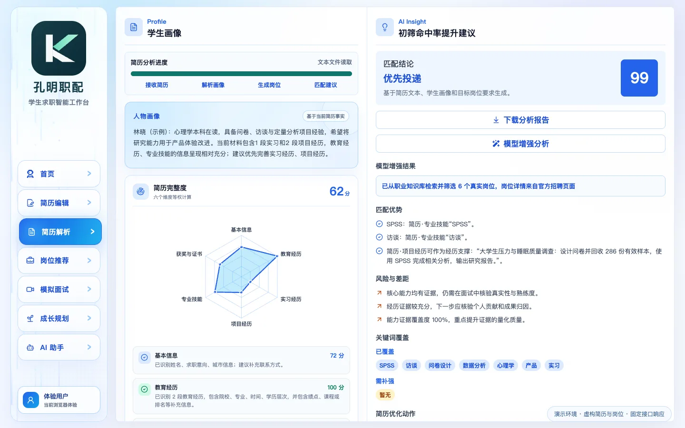</a><br><strong>04 · 查看画像与匹配依据</strong><br>核对教育、技能和经历，查看匹配解释与简历优化建议。</td>
  </tr>
  <tr>
    <td><a href="docs/media/jobs.webp">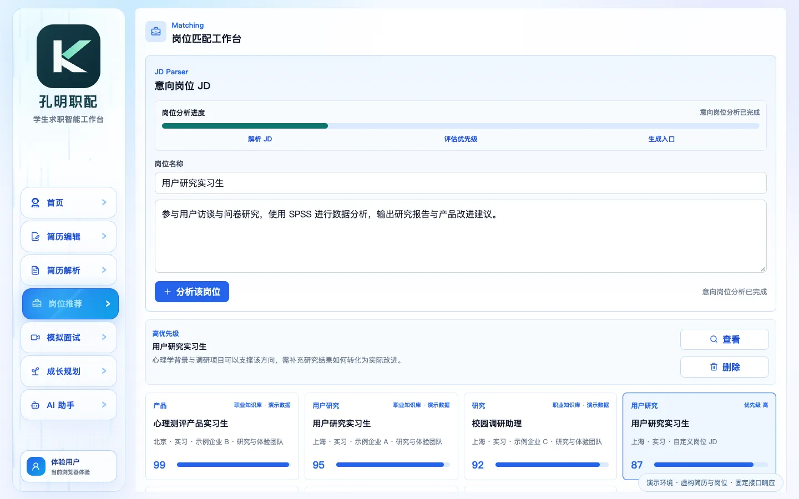</a><br><strong>05 · 分析目标岗位</strong><br>比较岗位要求与简历证据，分析自定义 JD。</td>
    <td><a href="docs/media/interview.webp"></a><br><strong>06 · 练习模拟面试</strong><br>围绕目标岗位回答问题、接受追问并生成复盘报告。</td>
  </tr>
  <tr>
    <td><a href="docs/media/growth.webp">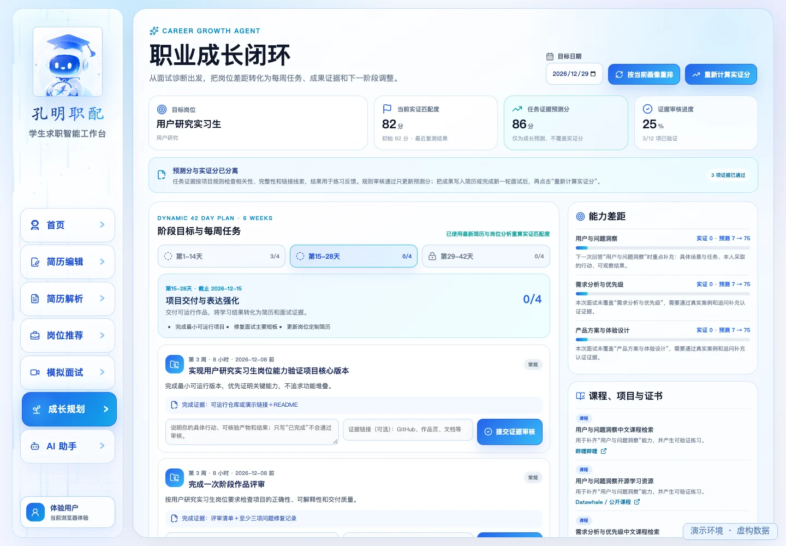</a><br><strong>07 · 制定成长计划</strong><br>把面试短板转为练习任务，提交成果证据并安排复测。</td>
    <td><a href="docs/media/assistant.webp">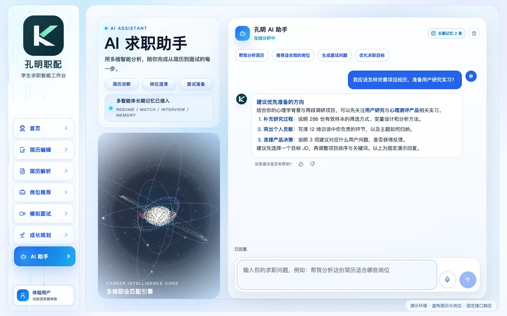</a><br><strong>08 · 讨论准备重点</strong><br>结合简历、岗位与历史对话，继续追问求职问题。</td>
  </tr>
  <tr>
    <td><a href="docs/media/console.webp">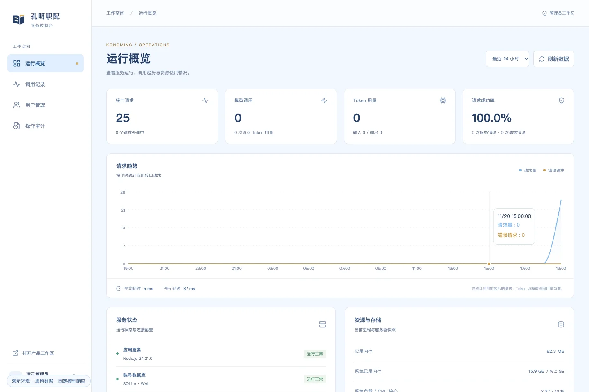</a><br><strong>09 · 查看服务运行</strong><br>管理员查看调用、用量、服务配置、资源与备份状态。</td>
    <td><a href="docs/media/users.webp">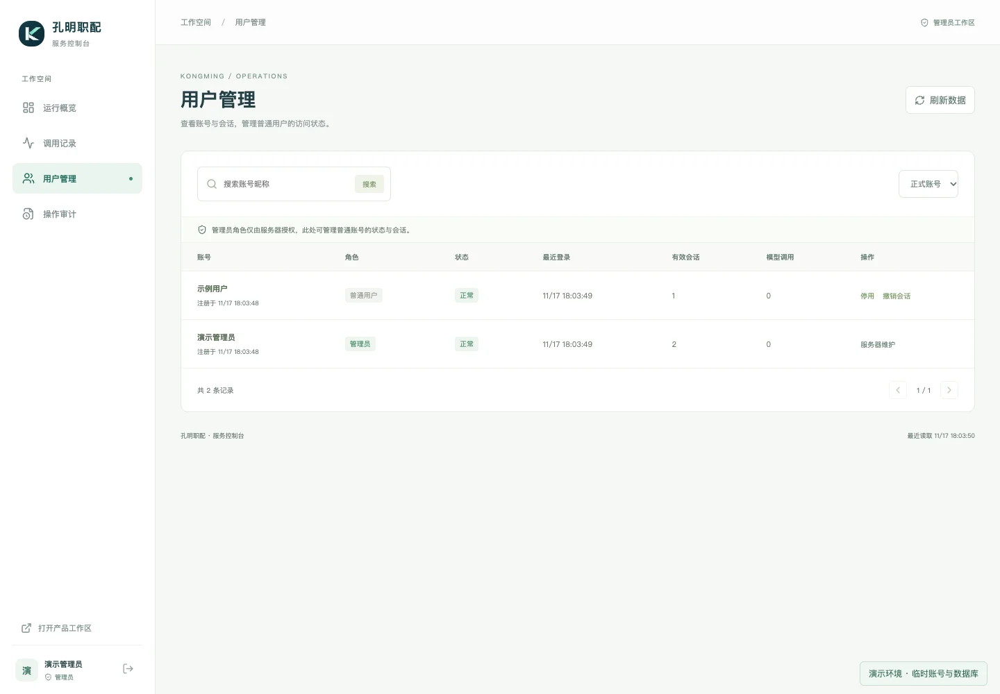</a><br><strong>10 · 管理账号与会话</strong><br>停用或恢复普通账号，撤销登录会话，查看操作审计。</td>
  </tr>
</table>

## 核心能力

| 能力 | 功能说明 |
| --- | --- |
| 多格式简历解析 | 支持 DOCX、PDF、图片、TXT / Markdown 与直接填写。优先读取 PDF 文字层，扫描件可通过 OCR 提取文本与坐标；旧版 DOC 需先转换。 |
| 学生画像与匹配解释 | 汇总教育、技能、项目和实习经历，从能力、经历、关键词、兴趣与成长潜力五个维度展示匹配情况。 |
| 岗位推荐与 JD 分析 | 支持自定义岗位描述；配置知识库后，使用向量检索与 BM25 混合召回，并保留岗位来源和核验时间。 |
| 简历优化与导出 | 提供关键词差距、经历表达与行动建议，支持复制优化稿、下载 Markdown 分析报告。 |
| 模拟面试 | 提供综合面、技术面和 HR 面练习，支持文字回答；语音与摄像头能力取决于浏览器和设备权限。 |
| AI 求职助手 | 结合简历、岗位、历史对话和反馈开展多轮问答，保存对话与反馈。 |
| 账号与工作区 | 注册登录或独立访客体验；按账号自动保存简历文字、结构化字段、岗位推荐、JD 草稿与岗位选择，刷新后恢复。 |
| 管理员服务控制台 | 请求趋势、成功率、平均 / P95 耗时、模型 Token 用量、服务配置、主机资源与数据库备份；支持账号状态管理、会话撤销与操作审计。 |
| 面试复盘与成长计划 | 按岗位能力维度整理回答证据，生成阶段报告或正式报告，保存薄弱项与练习任务，支持后续复测比较。 |

匹配分数来自项目内的规则计算，用于比较和解释当前简历与岗位的关系；尚未经真实录用结果校准，不代表录用概率。知识库不可用时，界面会提示并尝试提供模型生成的岗位方向建议。

## 快速开始

### 1. 安装依赖

需要 **Node.js 24.x** 和 npm。

```bash
git clone https://github.com/lljjcc426/Kongming-Student-Job-Matching-Agent.git
cd Kongming-Student-Job-Matching-Agent
npm ci
```

### 2. 配置模型

复制 [`.env.example`](.env.example) 为 `.env`，选择一种接入方式。自行部署需配置自己的 API Key，或连接自己运行的模型服务。

| 接入方式 | `MODEL_PROVIDER` | 适用服务 |
| --- | --- | --- |
| OpenAI | `openai` | OpenAI Chat Completions |
| Claude | `anthropic` | Anthropic Messages 原生接口 |
| 自定义兼容接口 | `openai-compatible` | DeepSeek、通义千问等提供的 OpenAI 兼容接口，以及 vLLM / LM Studio |
| Ollama | `ollama` | 本地运行的文本或视觉模型 |

以 **OpenAI** 为例，在 `.env` 中填写：

```dotenv
MODEL_PROVIDER=openai
MODEL_BASE_URL=https://api.openai.com/v1
MODEL_API_KEY=your_openai_api_key
MODEL_TEXT_MODEL=gpt-4.1-mini
MODEL_VISION_MODEL=gpt-4.1-mini
```

<details>
<summary><strong>使用 Claude</strong></summary>

```dotenv
MODEL_PROVIDER=anthropic
MODEL_BASE_URL=https://api.anthropic.com/v1
MODEL_API_KEY=your_claude_api_key
MODEL_TEXT_MODEL=claude-sonnet-4-6
MODEL_VISION_MODEL=claude-sonnet-4-6
```

使用 Anthropic 原生 Messages 接口，无需转换为 OpenAI 协议。

</details>

<details>
<summary><strong>使用本地模型（Ollama）</strong></summary>

安装并启动 [Ollama](https://ollama.com/)，下载支持图片的模型：

```bash
ollama pull qwen3-vl:8b
```

将 `.env` 改为：

```dotenv
MODEL_PROVIDER=ollama
MODEL_BASE_URL=http://127.0.0.1:11434/v1
MODEL_API_KEY=
MODEL_TEXT_MODEL=qwen3-vl:8b
MODEL_VISION_MODEL=qwen3-vl:8b
MODEL_REQUEST_TIMEOUT_MS=180000
```

模型需适合本机内存与算力；也可改为已安装的其他模型 ID。

</details>

文本和视觉模型可分别指定。视觉模型须支持图片输入；只使用文本模型时，可留空 `MODEL_VISION_MODEL`，扫描件与图片改走 OCR。模型 ID 以服务提供方及账号可用列表为准。

创建 API Key、配置自定义接口、调整超时与排查错误，见[模型配置教程](docs/configuration.md#模型接入)。

### 3. 启动工作台

```bash
node --env-file=.env --run dev
```

打开终端输出的本地地址，默认是 **http://localhost:5173**。注册并登录，或点击“访客体验”。进入“简历编辑”上传文件或直接填写字段；手动填写后点击“生成岗位推荐”，再进入简历解析、岗位推荐、模拟面试与成长规划。

工作区自动保存，注册账号可在重新登录后继续使用。PDF / 图片恢复为文字对照；查看原文件预览需重新上传原件。

仅浏览界面可直接运行 `npm run dev`；简历结构化、JD 分析与模型问答需要有效的模型配置。`node --env-file=.env` 用于将服务端变量加载到进程中。

管理员只能由部署者通过服务器命令授权；普通账号无法访问控制台。授权步骤与监控指标口径见[服务器部署](docs/deployment.md#管理员与服务控制台)。

### 可选：OCR 与岗位知识库

| 扩展 | 前置条件 | 指引 |
| --- | --- | --- |
| 扫描件 / 图片 OCR | Python 环境与 RapidOCR，或火山 OCR 凭据 | [OCR 接入](docs/12-ocr-integration.md) |
| 本地岗位知识库 | Python 3.11、岗位 JSONL、嵌入模型与 Qdrant 本地索引 | [安装与运行](docs/getting-started.md#本地岗位知识库) · [检索实现](docs/14-job-rag-knowledge-base.md) |

现有 `setup:ocr`、`setup:rag` 和 `build:job-index` 脚本面向 Windows / PowerShell，默认使用 D 盘路径。macOS / Linux 的配置方式见[安装与运行](docs/getting-started.md)。岗位数据、索引和模型权重需单独准备。

## 技术架构

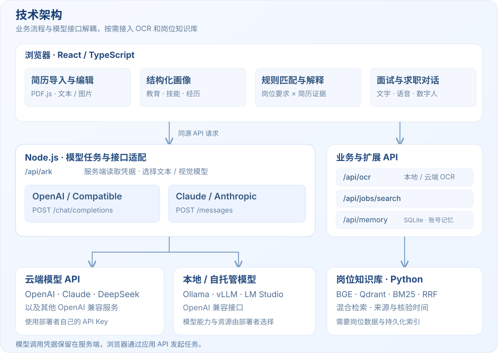

| 层级 | 技术与职责 |
| --- | --- |
| 交互界面 | React 19、TypeScript、Vite；Recharts 展示匹配维度，Three.js / React Three Fiber 呈现交互视觉。 |
| 任务编排 | 按简历处理、岗位分析、面试与对话组织任务；业务 hooks 与模型适配器管理状态和调用。 |
| 文档处理 | Mammoth 提取 DOCX 文字，PDF.js 读取 PDF，RapidOCR / 火山 OCR 处理扫描件与图片。 |
| 模型服务 | Node.js 服务端读取凭据并适配 OpenAI / Claude 协议，按任务选择文本或视觉模型；浏览器调用同源 API。 |
| 账号与运维 | SQLite WAL、版本迁移、服务端角色鉴权；保存独立账号工作区、对话、面试与成长计划，记录请求指标和管理审计，支持在线备份。 |
| 可选检索 | Python、LlamaIndex、BGE、Qdrant、BM25 与 RRF 融合，支持多查询召回与可选重排。 |

岗位知识库需要独立的 Python 环境、岗位数据和持久化索引。构建后可使用 `node --env-file=.env --run start` 同时提供页面与 API；`npm run preview` 仅预览静态产物。详见[模型配置](docs/configuration.md)与[服务器部署](docs/deployment.md)。

## 仓库结构

```text
.
├── src/                 # 前端页面、组件、业务流程与模型适配器
│   ├── pages/           # 用户工作区与管理员控制台
│   ├── features/        # 简历、岗位、面试、成长计划与工作区持久化
│   └── components/      # 品牌、可视化、布局与业务组件
├── server/              # 账号鉴权、运维指标、模型代理、OCR 与岗位检索
├── api/                 # 模型与 OCR HTTP 入口
├── scripts/             # 环境准备、岗位采集与验证工具
├── public/              # 数字人、PDF 字体映射与静态资源
├── docs/                # 使用文档、设计资料与演示素材
└── .github/             # Issue 与 Pull Request 模板
```

## 文档与贡献

| 开始使用 | 了解实现 | 参与开发 |
| --- | --- | --- |
| [安装与运行](docs/getting-started.md) | [前端模块化](docs/13-frontend-modularization.md) | [贡献指南](CONTRIBUTING.md) |
| [配置与部署](docs/configuration.md) | [OCR 接入](docs/12-ocr-integration.md) | [报告问题](https://github.com/lljjcc426/Kongming-Student-Job-Matching-Agent/issues/new/choose) |
| [演示素材](docs/media/README.md) | [岗位知识库](docs/14-job-rag-knowledge-base.md) | [提出改进](https://github.com/lljjcc426/Kongming-Student-Job-Matching-Agent/issues/new?template=feature_request.yml) |

完整的设计、调研与方案资料见[文档中心](docs/README.md)。欢迎提交可复现的问题、使用反馈与改进方案。

## 许可证

项目采用 [Apache License 2.0](LICENSE)。第三方依赖及随附资源遵循各自的许可声明，已有声明保留在对应目录中。
