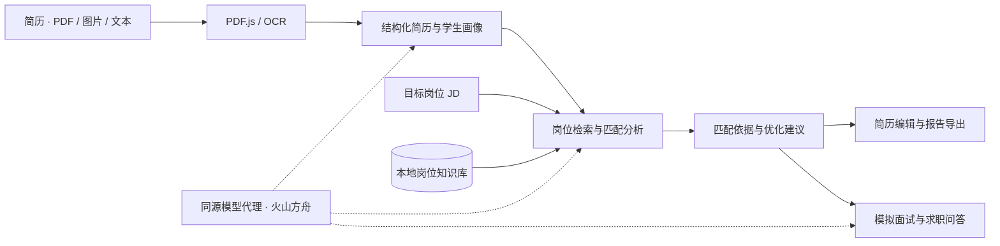

<p align="center">
  
</p>

<h1 align="center">孔明职配 · Kongming</h1>

<p align="center"><strong>读懂简历，理解岗位，准备下一步。</strong></p>
<p align="center">面向学生求职的 AI 工作台，连接简历解析、岗位匹配、简历优化与模拟面试。</p>

<p align="center">
  <a href="LICENSE"></a>
  <a href="package.json"></a>
  <a href="package.json"></a>
  <a href="tsconfig.json"></a>
</p>

<p align="center">
  <strong>简体中文</strong> · <a href="README.en.md">English</a><br>
  <a href="#产品演示">产品演示</a> · <a href="#核心能力">核心能力</a> · <a href="#快速开始">快速开始</a> · <a href="#技术架构">技术架构</a> · <a href="docs/README.md">文档中心</a> · <a href="CONTRIBUTING.md">参与贡献</a>
</p>

## 项目介绍

孔明职配将学生简历与目标岗位放在同一个工作流中：提取教育、技能和经历，分析岗位要求与简历证据的关联，生成有依据的匹配说明与修改建议，再围绕目标岗位开展面试练习。

项目采用 React + TypeScript 构建交互界面，通过同源服务接入火山方舟模型；可选启用 OCR 与本地岗位知识库。当前版本为可运行的应用原型。

## 产品演示

[](docs/media/kongming-demo.mp4?raw=true)

<p align="center">
  <a href="docs/media/kongming-demo.mp4?raw=true"><strong>▶ 观看完整演示视频</strong></a> · <a href="docs/media/README.md">素材与录制说明</a>
</p>

演示展示实际运行的前端，使用虚构简历与固定接口响应，说明页面交互和结果呈现；模型效果与真实岗位检索需配置对应服务后体验。

<table>
  <tr>
    <td width="50%"><br><strong>简历解析</strong><br>将教育、技能和经历组织为可检查的学生画像。</td>
    <td width="50%"><br><strong>岗位匹配</strong><br>比较岗位要求，查看匹配依据，分析自定义 JD。</td>
  </tr>
  <tr>
    <td><br><strong>简历编辑</strong><br>对照原文检查字段，完善简历内容与表达。</td>
    <td><br><strong>模拟面试</strong><br>围绕目标岗位练习综合面、技术面与 HR 面。</td>
  </tr>
</table>

## 核心能力

| 能力 | 功能说明 |
| --- | --- |
| 多格式简历解析 | 支持文本、Markdown、PDF 和图片。优先读取 PDF 文字层，扫描件可通过 OCR 提取文本与坐标。 |
| 学生画像与匹配解释 | 汇总教育、技能、项目和实习经历，从能力、经历、关键词、兴趣与成长潜力五个维度展示匹配情况。 |
| 岗位推荐与 JD 分析 | 支持自定义岗位描述；配置知识库后，使用向量检索与 BM25 混合召回，并保留岗位来源和核验时间。 |
| 简历优化与导出 | 提供关键词差距、经历表达与行动建议，支持复制优化稿、下载 Markdown 分析报告。 |
| 模拟面试 | 提供综合面、技术面和 HR 面练习，支持文字回答；语音与摄像头能力取决于浏览器和设备权限。 |
| AI 求职助手 | 结合当前简历、目标岗位和匹配结果开展多轮问答，辅助梳理求职方向与准备重点。 |

匹配分数来自项目内的规则计算，用于比较和解释当前简历与岗位的关系；尚未经真实录用结果校准，不代表录用概率。知识库不可用时，界面会提示并尝试提供模型生成的岗位方向建议。

## 快速开始

### 1. 安装依赖

需要 **Node.js 24.x** 和 npm。

```bash
git clone https://github.com/lljjcc426/Kongming-Student-Job-Matching-Agent.git
cd Kongming-Student-Job-Matching-Agent
npm ci
```

### 2. 配置模型

将 [`.env.example`](.env.example) 复制为 `.env`，填写火山方舟 API Key 与账号可用的模型 ID：

```dotenv
ARK_API_KEY=your_ark_api_key
ARK_TEXT_MODEL=your_text_model_id
ARK_VISION_MODEL=your_vision_model_id
```

### 3. 启动工作台

```bash
node --env-file=.env --run dev
```

打开终端输出的本地地址，默认是 **http://localhost:5173**。上传简历后，可依次进入简历解析、岗位推荐、模拟面试与 AI 助手。

仅浏览界面可直接运行 `npm run dev`；简历结构化、JD 分析与模型问答需要有效的模型配置。`node --env-file=.env` 用于将服务端变量加载到进程中。

### 可选：OCR 与岗位知识库

| 扩展 | 前置条件 | 指引 |
| --- | --- | --- |
| 扫描件 / 图片 OCR | Python 环境与 RapidOCR，或火山 OCR 凭据 | [OCR 接入](docs/12-ocr-integration.md) |
| 本地岗位知识库 | Python 3.11、岗位 JSONL、嵌入模型与 Qdrant 本地索引 | [安装与运行](docs/getting-started.md#本地岗位知识库) · [检索实现](docs/14-job-rag-knowledge-base.md) |

现有 `setup:ocr`、`setup:rag` 和 `build:job-index` 脚本面向 Windows / PowerShell，默认使用 D 盘路径。macOS / Linux 的配置方式见[安装与运行](docs/getting-started.md)。岗位数据、索引和模型权重需单独准备。

## 技术架构



| 层级 | 技术与职责 |
| --- | --- |
| 交互界面 | React 19、TypeScript、Vite；Recharts 展示匹配维度，Three.js / React Three Fiber 呈现交互视觉。 |
| 任务编排 | 按简历处理、岗位分析、面试与对话组织任务；业务 hooks 与模型适配器管理状态和调用。 |
| 文档处理 | PDF.js、RapidOCR / 火山 OCR，保留文字与位置之间的关联。 |
| 模型服务 | 开发环境由 Vite 提供同源代理，Vercel 函数处理模型与云端 OCR 请求。 |
| 可选检索 | Python、LlamaIndex、BGE、Qdrant、BM25 与 RRF 融合，支持多查询召回与可选重排。 |

本地 Qdrant / Python 工作进程依赖持久化磁盘，不能直接运行在 Vercel Serverless 中。`npm run preview` 仅预览静态构建产物，不提供开发环境的 API 代理。详见[配置与部署](docs/configuration.md)。

## 仓库结构

```text
.
├── src/                 # 前端页面、组件、业务流程与模型适配器
│   ├── pages/           # 首页、简历、岗位、面试与助手页面
│   ├── features/        # 简历处理、岗位检索、匹配解释与对话
│   └── components/      # 品牌、可视化、布局与业务组件
├── server/              # 模型代理、OCR 与本地岗位知识库服务
├── api/                 # Vercel 模型与 OCR 函数入口
├── scripts/             # 环境准备、岗位采集与验证工具
├── public/              # 数字人、PDF 字体映射与静态资源
├── docs/                # 使用文档、设计资料与演示素材
└── .github/             # Issue 与 Pull Request 模板
```

## 文档与贡献

| 开始使用 | 了解实现 | 参与开发 |
| --- | --- | --- |
| [安装与运行](docs/getting-started.md) | [前端模块化](docs/13-frontend-modularization.md) | [贡献指南](CONTRIBUTING.md) |
| [配置与部署](docs/configuration.md) | [OCR 接入](docs/12-ocr-integration.md) | [报告问题](https://github.com/lljjcc426/Kongming-Student-Job-Matching-Agent/issues/new/choose) |
| [演示素材](docs/media/README.md) | [岗位知识库](docs/14-job-rag-knowledge-base.md) | [提出改进](https://github.com/lljjcc426/Kongming-Student-Job-Matching-Agent/issues/new?template=feature_request.yml) |

完整的设计、调研与方案资料见[文档中心](docs/README.md)。欢迎提交可复现的问题、使用反馈与改进方案。

## 许可证

项目采用 [Apache License 2.0](LICENSE)。第三方依赖及随附资源遵循各自的许可声明，已有声明保留在对应目录中。
